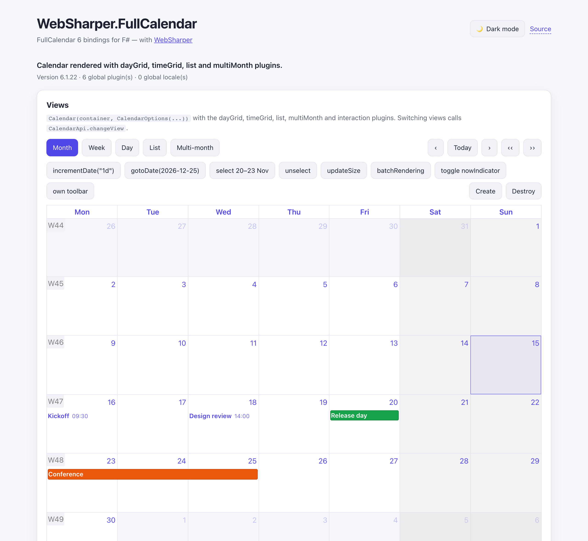

# WebSharper.FullCalendar API Binding

[](https://www.nuget.org/packages/WebSharper.FullCalendar)

An F# [WebSharper](https://websharper.com/) binding for the
[FullCalendar](https://fullcalendar.io/) JavaScript library, so you can build
interactive calendars — month, week, day, list and multi-month views — with
strongly typed F#.

- **FullCalendar 6.1.x** (`@fullcalendar/core` plus the `daygrid`, `timegrid`,
  `list`, `multimonth` and `interaction` plugins).
- Everything is **npm-based**: the binding imports the packages with
  `ImportDefault`/`Import`, so the sample bundles them with esbuild and there is
  no CDN `<script>` to add.
- The binding models the **whole public API**: `CalendarOptions`, every
  listener and content generator, `CalendarApi`, `EventApi`, views, event
  sources and the top-level helpers (`formatDate`, `formatRange`,
  `createPlugin`, `version`, `globalLocales`, `globalPlugins`).

## Live demos

**Try it live:** [Open the sample in your browser](https://dotnet-websharper.github.io/fullcalendar/)



The sample doubles as the binding's [test case](#running-the-test-case): it
renders a calendar with all five plugins, switches views, creates events by
clicking and dragging, mutates them through `EventApi`, adds an event source,
formats dates and installs an `ExternalDraggable` — logging every listener call.

## Repository structure

| Project | Description |
| --- | --- |
| `WebSharper.FullCalendar` | The binding (`netstandard2.0`). |
| `WebSharper.FullCalendar.Sample` | Static SPA sample, built with esbuild into `dist/`. |

## Install

```bash
dotnet add package WebSharper.FullCalendar
```

or, in Paket:

```
nuget WebSharper.FullCalendar
```

The binding declares its npm dependencies, so the packages are pulled in
automatically:

```xml
<NpmDependencies>
  <NpmPackage Name="@fullcalendar/core" Version="&gt;= 6.1.22 &lt; 7.0.0" ResolutionStrategy="Max" />
  <NpmPackage Name="@fullcalendar/daygrid" Version="&gt;= 6.1.22 &lt; 7.0.0" ResolutionStrategy="Max" />
  <NpmPackage Name="@fullcalendar/interaction" Version="&gt;= 6.1.22 &lt; 7.0.0" ResolutionStrategy="Max" />
  <NpmPackage Name="@fullcalendar/list" Version="&gt;= 6.1.22 &lt; 7.0.0" ResolutionStrategy="Max" />
  <NpmPackage Name="@fullcalendar/multimonth" Version="&gt;= 6.1.22 &lt; 7.0.0" ResolutionStrategy="Max" />
  <NpmPackage Name="@fullcalendar/timegrid" Version="&gt;= 6.1.22 &lt; 7.0.0" ResolutionStrategy="Max" />
</NpmDependencies>
```

## Usage

```fsharp
open WebSharper
open WebSharper.JavaScript
open WebSharper.UI
open WebSharper.UI.Client
open WebSharper.UI.Templating
open WebSharper.FullCalendar

[<JavaScript>]
module Client =

    type IndexTemplate = Template<"index.html", ClientLoad.FromDocument>

    [<SPAEntryPoint>]
    let Main () =
        IndexTemplate()
            .PageInit(fun _ -> ())
            .Bind()

        // FullCalendar needs an HTMLElement; `getElementById` returns Dom.Element.
        let el = As<HTMLElement> (JS.Document.GetElementById "calendar")

        let calendar =
            Calendar(
                el,
                CalendarOptions(
                    InitialView = "dayGridMonth",
                    Selectable = true,
                    Editable = true,
                    DayMaxEvents = true,
                    Events = [|
                        EventRefiners(Title = "Kickoff", Start = "2026-11-16T09:30:00")
                        EventRefiners(Title = "Release day", Start = "2026-11-20", AllDay = true)
                    |],
                    Plugins = [|
                        FullCalendar.InteractionPlugin
                        FullCalendar.DayGridPlugin
                    |],
                    DateClick = fun (info: DateClickArg) ->
                        info.View.Calendar.AddEvent(
                            EventRefiners(Title = "New event", Start = info.DateStr, AllDay = true)
                        )
                        |> ignore
                )
            )

        calendar.Render()
```

### Typed options

Option values are typed as the **input** FullCalendar accepts, not as its
internal refiners:

- durations (`Duration`, `SlotDuration`, `SnapDuration`, `SlotLabelInterval`,
  `NextDayThreshold`, …) take a `DurationInput`: a string (`"01:30"`, `"2d"`),
  a number of milliseconds, or a `DurationObjectInput`.
- formatters (`TitleFormat`, `EventTimeFormat`, `DayHeaderFormat`, …) take a
  `FormatterInput`: a string, a `NativeFormatterOptions`, or a function of
  `VerboseFormattingArg`.
- `NativeFormatterOptions` exposes the `Intl.DateTimeFormat` granularities as
  typed enums, e.g.
  `NativeFormatterOptions(Year = NumericStyle.Numeric, Month = MonthStyle.Long, Hour = NumericStyle.TwoDigit, Hour12 = false)`.
- content and class-name generators are typed callbacks:
  `EventContent` is a `System.Func<EventContentArg, obj>` returning
  `ObjCustomContent(Html = …)`, `DayCellClassNames` returns a class name or a
  string array, `EventDidMount`/`EventWillUnmount` receive a mount argument with
  the DOM element.

### Plugins

Every plugin is exposed as a `PluginDef` static on `FullCalendar`, and each one
is imported from its own npm package:

| Member | Package |
| --- | --- |
| `FullCalendar.DayGridPlugin` | `@fullcalendar/daygrid` |
| `FullCalendar.TimegridPlugin` | `@fullcalendar/timegrid` |
| `FullCalendar.ListPlugin` | `@fullcalendar/list` |
| `FullCalendar.MultimonthPlugin` | `@fullcalendar/multimonth` |
| `FullCalendar.InteractionPlugin` | `@fullcalendar/interaction` |

`CalendarOptions.Plugins` is a plain array, so plugin-specific options
(`SlotMinTime`, `AllDaySlot`, `DayMaxEvents`, `MultiMonthMaxColumns`,
`FixedMirrorParent`, `ListDayFormat`, …) are all available on the same record.

A custom plugin can be built with the top-level `FullCalendar.CreatePlugin`:

```fsharp
FullCalendar.CreatePlugin(PluginDefInput("my-plugin"))
```

### Event sources

`EventSourceInput` accepts an array of event objects, an `EventSourceInputObject`
(with `url`, `method`, `extraParams`, `events` as an array **or** a function),
or an `EventSourceFunc` itself:

```fsharp
calendar.AddEventSource(
    EventSourceInputObject(
        Url = "/api/events",
        ExtraParams = (fun () -> …)
    )
)
```

### Internal classes

FullCalendar keeps its implementation types (`DateEnv`, `CalendarImpl`,
`EventImpl`, `Slicer`, the view classes, …) behind the `@fullcalendar/core/internal`
(and `@fullcalendar/<plugin>/internal`) entry points. The binding mirrors them
under `WebSharper.FullCalendar.Core`/`.DaygridPlugin`/… and imports from those
subpaths, so advanced plugin work is possible. A few classes that the packages
declare but do **not** export (for example `PointerDragging` and
`FeaturefulElementDragging` from the interaction plugin) are modelled as
type-only: you can read the objects handed back by `ExternalDraggable`, but you
cannot construct them.

### Locales

`CalendarOptions.Locales` takes `LocaleInput[]` and `Locale` a locale code, but
the locale data itself lives in `@fullcalendar/core/locales/*`. The binding does
not re-export those modules; add the locale module with an inline import in your
own project and pass it through `Locales`:

```fsharp
[<Inline "import('$module').then(m => m.default)">]
let localeModule (moduleName: string) : Promise<LocaleInput> = X<_>
```

## Notes

- **FullCalendar 7** moved the library into the framework packages
  (`@full-ui/headless-calendar`, `@fullcalendar/react/daygrid`, …); the
  `@fullcalendar/core` 7 package is a types-only stub. This binding deliberately
  tracks the 6.1 line until a v7 binding is designed.
- The sample is **light themed by default** and has a light/dark switcher that
  persists the choice in `localStorage`. FullCalendar's own styles are themed
  through its `--fc-*` CSS variables.

## Running the test case

The sample is a static SPA. Build it, then serve `dist/`:

```bash
dotnet tool install -g dotnet-serve   # once
dotnet tool restore && dotnet paket restore
dotnet build WebSharper.FullCalendar.Sample/WebSharper.FullCalendar.Sample.fsproj -c Release
dotnet serve -d dist -p 5202
```

Open <http://localhost:5202/>. The page exercises:

- rendering with `dayGrid`, `timeGrid`, `list`, `multiMonth` and `interaction`;
- `changeView`/`prev`/`next`/`today`/`gotoDate`/`incrementDate`/`zoom`, `select`/
  `unselect`, `updateSize`, `batchRendering`, `setOption`/`getOption`;
- `addEvent`/`getEventById`/`getEvents`/`removeAllEvents`, and `EventApi`
  `setProp`/`setExtendedProp`/`moveDates`/`setAllDay`/`remove`/`toPlainObject`/
  `toJSON`/`formatRange`;
- event sources (`addEventSource`/`getEventSources`/`refetchEvents`);
- `formatDate`/`formatRange`/`formatIso` and the top-level
  `FullCalendar.formatRange`/`version`/`globalPlugins`/`globalLocales`;
- listeners: `dateClick`, `select`, `unselect`, `eventClick`,
  `eventMouseEnter`/`Leave`, `eventDrop`, `eventResize`, `eventAdd`,
  `eventChange`, `eventRemove`, `datesSet`, `eventsSet`, `loading`,
  `viewDidMount` and `windowResize`;
- content generators: `dayHeaderContent`, `dayCellClassNames`,
  `slotLabelContent`, `eventContent`, `eventDidMount`;
- `ExternalDraggable` from the interaction plugin.

## Build from source

Prerequisites: the .NET 11 SDK (the WebSharper 11 compiler runs on the .NET 11
runtime) and Node.js.

```bash
git clone https://github.com/dotnet-websharper/fullcalendar.git
cd fullcalendar

# dependencies are managed by Paket
dotnet tool restore
dotnet paket restore

# the binding
dotnet build WebSharper.FullCalendar/WebSharper.FullCalendar.fsproj -c Release

# the sample: WebSharper output goes to WebSharper.FullCalendar.Sample/build,
# then esbuild bundles it into dist/
dotnet build WebSharper.FullCalendar.Sample/WebSharper.FullCalendar.Sample.fsproj -c Release

dotnet serve -d dist -p 5202
```

## Pack

```bash
dotnet fsi ./build.fsx -t WS-Package
```

The resulting `WebSharper.FullCalendar.nupkg` contains the binding assembly
(with its WebSharper metadata sidecar), the XML documentation and the package
dependencies.

## Deployment

`.github/workflows/ghpages.yml` builds the sample in Release and publishes
`dist/` to the `gh-pages` branch with `peaceiris/actions-gh-pages`. The deploy
runs only from the default branch.

## Upstream license (FullCalendar)

The binding's own code is Apache 2.0, but the JavaScript library it binds is
licensed differently — **MIT** (SPDX: `MIT`) — for the packages this binding
declares (`@fullcalendar/core`, `daygrid`, `interaction`, `list`, `multimonth`
and `timegrid`, version **6.1.22**, copyright © 2021 Adam Shaw).

- Upstream license: <https://github.com/fullcalendar/fullcalendar/blob/v6.1.22/LICENSE.md>
- Licensing page: <https://fullcalendar.io/license>

MIT is permissive, not copyleft: it allows commercial and closed-source use,
and there is no obligation to publish your own code. The one requirement is
that the copyright notice and permission notice travel with copies of the
library — which matters when you ship the bundled JavaScript the binding
produces (the notice is included in each npm package, so it is preserved by
the bundler's license comments). The binding itself ships no upstream source,
only the npm dependency declarations.

## License

Apache 2.0 — see [LICENSE.md](LICENSE.md).